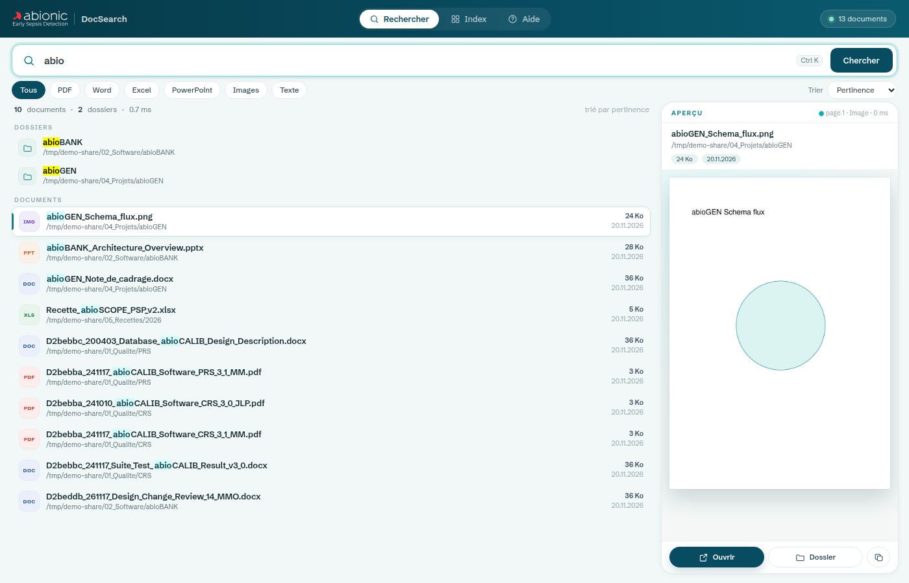
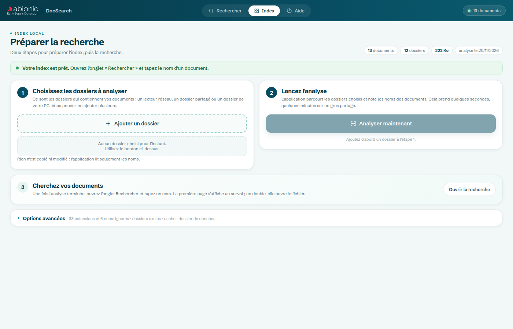
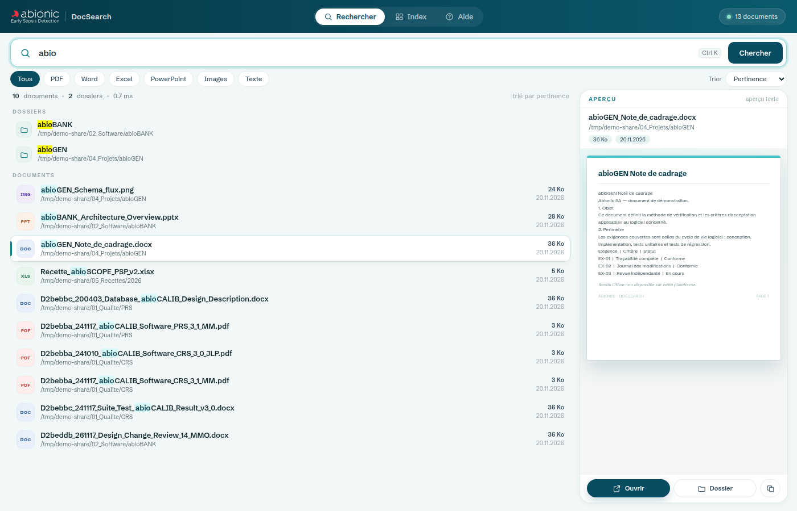

# Abionic DocSearch

Application de bureau Windows pour retrouver un document dans le partage du
service et en voir la première page sans quitter l'application.

Plus de terminal, plus de page `localhost` : un seul exécutable, une fenêtre,
une recherche instantanée.



## Ce que fait l'application

- **Indexe les noms** de fichiers et de dossiers d'un ou plusieurs partages
  (lecteur réseau, dossier local). Aucun document n'est ouvert pendant le
  scan : 200 000 fichiers prennent une quinzaine de secondes.
- **Ignore par défaut** les archives (zip, rar, 7z…), les exécutables, les
  fichiers système et temporaires, et les fichiers de verrouillage Office
  (`~$…`). La liste est visible et modifiable dans les options avancées.
- **Cherche en moins d'une milliseconde**, sans tenir compte des accents ni
  des majuscules, avec recherche par préfixe et par phrase entre guillemets.
  `calib` trouve `abioCALIB`, `definitif` trouve `définitif`.
- **Prévisualise la première page au survol** :
  - PDF et images : rendu réel de la page ;
  - Word, Excel, PowerPoint : le texte s'affiche immédiatement, puis la vraie
    page arrive dès que l'Office du poste a fini la conversion ;
  - si Office ne répond pas : la page texte reste affichée.
- **Résiste aux fichiers abîmés** : les DOCX dont le conteneur est incohérent
  sont lus directement dans leur XML, les CSV/WebP sont gérés, les tableaux
  Word, Excel et PowerPoint sont extraits.
- **Ouvre le document** dans Office ou le lecteur PDF, affiche son dossier
  dans l'Explorateur, copie son chemin.
- **Garde tout en local** : l'index et le cache d'aperçus restent sur le
  poste, dans un dossier `data` à côté de l'exécutable.

| Index local | Aperçu Word |
| --- | --- |
|  |  |

## Installer

1. Ouvrir la page **Releases** du dépôt.
2. Télécharger `AbionicDocSearch-windows.zip` et le décompresser où vous voulez
   (Bureau, `Documents`, une clé USB…).
3. Double-cliquer `AbionicDocSearch.exe`.

Pas d'installation, pas de droit administrateur. Windows peut afficher
« Windows a protégé votre PC » : *Informations complémentaires* puis
*Exécuter quand même* (l'exécutable n'est pas signé).

La ligne de commande est fournie à part, dans
`abio-docsearch-cli-windows.zip`, pour ceux qui scriptent des scans.

### Prérequis

- Windows 10 ou 11 avec **Microsoft Edge WebView2** (présent par défaut).
- Microsoft Office pour les aperçus fidèles des fichiers Word/Excel/PowerPoint.
  Sans Office, un aperçu texte est affiché.

## Utiliser

1. Onglet **Index** → **Ajouter un dossier** → choisir le lecteur réseau
   (`T:\`, `\\srv-file\abioSERVER\...`) → **Analyser maintenant**.
2. Onglet **Rechercher** → taper un nom, un dossier ou quelques mots.
3. Survoler un résultat pour voir la première page, double-cliquer pour ouvrir.

Le résultat d'une recherche de dossier propose deux boutons : **Chercher ici**
limite la recherche à ce dossier (un bandeau `Dans : CRS ×` rappelle le filtre,
la croix le retire) et l'icône dossier l'ouvre dans l'Explorateur.

L'aperçu se feuillete : `1 / 12` sous la page, `+`/`−` pour zoomer (ou
`Ctrl`+molette), `100 %` pour revenir à la taille normale. Sous la liste,
**Afficher les suivants** charge la suite quand il y a plus de 200 résultats ;
le nombre total réel est toujours affiché.

Si Office ne répond pas, l'aperçu texte reste affiché avec un bouton
**Réessayer** : inutile de relancer l'application.

Raccourcis : `Ctrl+K` recherche, `↑`/`↓` naviguer, `Entrée` ouvrir,
`Alt+←`/`Alt+→` résultats précédents/suivants, `Alt+↑`/`Alt+↓` page
précédente/suivante, `Ctrl+C` copier le chemin, `Échap` retirer le dossier
puis effacer.

Relancer l'analyse après des changements est rapide : le scan est incrémental
et ne relit que les noms.

## Où sont les données

Tout reste dans **un seul dossier**, `data`, à côté de l'exécutable :

| Élément | Emplacement |
| --- | --- |
| Index | `data/index.db` |
| Aperçus en cache | `data/previews/` |
| Réglages (dossiers analysés) | `data/config.json` |
| Journal de démarrage | `data/crash.log` |
| Journal d'analyse | `data/scan-errors.log` |

Exemple : exe dans `C:\Users\MMO\tools\docsearch\` →
`C:\Users\MMO\tools\docsearch\data\`.

Le dossier est choisi dans cet ordre, et l'interface affiche lequel a été
retenu :

1. `DOCSEARCH_DATA` (variable d'environnement, réservée aux scripts) ;
2. `donnees.txt` à côté de l'exécutable — **seulement s'il désigne un dossier
   qui contient `index.db`** ;
3. `data` à côté de l'exécutable ;
4. `%LOCALAPPDATA%\Abionic\DocSearch` (exe placé dans un dossier protégé).

Un `donnees.txt` qui pointe vers un dossier vide ou supprimé est ignoré et
signalé en clair dans l'interface. C'était la cause d'un index introuvable
alors que la bibliothèque existait : l'application travaillait silencieusement
dans un dossier vide.

**Vérifier ou réparer** : *Options avancées → Dossier de données* montre le
chemin utilisé, son origine, le nombre de documents, la taille de l'index et
les autres emplacements examinés. Le bouton `Copier le diagnostic` met ce
rapport dans le presse-papiers. En ligne de commande :
`abio-docsearch-cli diag`.

Déplacer l'exécutable ne perd pas la bibliothèque : si le `data` voisin est
vide alors que `%LOCALAPPDATA%\Abionic\DocSearch` contient un index fourni,
l'application réutilise ce dernier. Le bouton **Choisir…** force un dossier
précis et le mémorise dans `donnees.txt`.

Une analyse dont un dossier demandé est inaccessible (partage déconnecté,
droits retirés) ne supprime plus rien : l'index précédent est conservé et
l'interface indique le dossier en cause.

Rien n'est envoyé sur le réseau. L'application ne lit un document qu'au moment
où tu survoles son résultat.

## Fichiers ignorés

Par défaut, ces fichiers ne sont jamais indexés :

- archives : `.zip`, `.rar`, `.7z`, `.tar`, `.gz`, `.tgz`, `.bz2`, `.xz`,
  `.cab`, `.iso` ;
- exécutables et bibliothèques : `.exe`, `.msi`, `.dll`, `.sys`, `.drv`,
  `.so`, `.bat`, `.cmd`, `.ps1`, `.vbs`, `.jar` ;
- fichiers temporaires ou de sauvegarde : `.tmp`, `.temp`, `.bak`, `.old`,
  `.dmp`, `.part`, `.lnk` ;
- bases et journaux : `.db`, `.sqlite`, `.mdb`, `.log` ;
- noms spéciaux : `Thumbs.db`, `desktop.ini`, `.DS_Store`, `~$*` (verrous
  Office), `*.tmp`, `*.bak`.

La liste complète est dans **Index → Options avancées → Fichiers ignorés**.
Retirer une ligne puis relancer l'analyse réintègre ces fichiers. Les fichiers
déjà indexés qui deviennent exclus sont supprimés de l'index au scan suivant.

## Ligne de commande

```powershell
.\abio-docsearch-cli.exe scan --root "T:\_D2_Research_and_Development" --threads 8
.\abio-docsearch-cli.exe search "CRS abioCALIB" --type pdf
.\abio-docsearch-cli.exe stats
```

`search` accepte `--json`, `--limit`, `--sort` (`relevance`, `date`, `name`,
`size`) et `--ext .pdf`.

## Développer

```bash
python -m venv .venv
.venv/Scripts/activate        # Windows
pip install -r requirements.txt -r requirements-dev.txt
pytest -q
python launcher_gui.py
```

Sous Linux ou macOS, le rendu Office n'est pas disponible : les aperçus Word,
Excel et PowerPoint sont reconstruits à partir du texte. C'est le seul écart
avec Windows.

Pour vérifier l'interface dans un navigateur sans ouvrir de fenêtre native :

```bash
DOCSEARCH_DATA=/tmp/demo-data python tools/dev_server.py 8899
```

### Construire l'exécutable

Le build se fait sur Windows, dans GitHub Actions (`.github/workflows/build.yml`) :

- tests ;
- `AbionicDocSearch.exe` (fenêtre, sans console) ;
- `abio-docsearch-cli.exe` (console) ;
- deux zips (application, ligne de commande) + empreintes SHA-256, publiés
  en Release sur un tag `v*`.

En local, sur Windows :

```powershell
pip install pyinstaller
pyinstaller --onefile --windowed --name AbionicDocSearch `
  --icon docsearch/ui/assets/favicon.ico `
  --add-data "docsearch/ui;docsearch/ui" `
  --collect-all webview launcher_gui.py
```

## Architecture

```
docsearch/
  app.py        fenêtre native pywebview + pont JavaScript
  catalog.py    parcours des noms, SQLite FTS5, recherche
  preview.py    première page PDF (PyMuPDF), Office (COM), cache
  cli.py        scan / search / stats
  ui/           interface (HTML, CSS, JS, polices, logo)
launcher_gui.py point d'entrée de l'exécutable fenêtré
launcher_cli.py point d'entrée de l'exécutable console
tools/          générateur de corpus, serveur de développement
```

- **Aucun serveur HTTP** dans l'application : `pywebview` charge les fichiers
  embarqués et expose les fonctions Python à JavaScript.
- **SQLite FTS5** avec `remove_diacritics`, index externe sur la table `docs`.
  Les noms sont aussi indexés découpés aux frontières de mots
  (`abioCALIB` → `abio CALIB`) pour que `calib` fonctionne.
- **Aperçus** : PyMuPDF pour les pages PDF et images (repli Pillow pour le
  WebP), automation COM (`Word.Application`, `Excel.Application`,
  `PowerPoint.Application`) pour les formats Office, avec délai maximal et
  repli texte. Le DOCX est lu directement dans `word/document.xml` : ni styles
  ni relations ne sont nécessaires. Cache disque indexé par chemin + taille +
  date, plafonné à 800 Mo.
- **Audit des aperçus** : `docs/rapport-apercus.md` recense 97 cas (tableaux,
  images, PDF chiffrés, DOCX abîmés, feuilles masquées…) et les correctifs
  associés.

## Chemins longs

Les partages Abionic contiennent des chemins qui dépassent la limite de
Windows (260 caractères). L'analyse, la recherche et l'aperçu les prennent en
charge. Si Windows refuse l'ouverture directe, le document s'ouvre depuis une
copie temporaire, avec un message qui le signale.

## Limites connues

- Le contenu des documents n'est pas indexé, seulement les noms de fichiers et
  de dossiers. C'est ce qui permet de scanner 500 000 fichiers en quelques
  secondes.
- Les fichiers protégés par mot de passe ne peuvent pas être prévisualisés.
- L'exécutable n'est pas signé : SmartScreen demande une confirmation au
  premier lancement.

---

Projet interne Abionic SA. Les polices (Schibsted Grotesk, licence OFL) et le
logo sont inclus pour l'interface uniquement.
